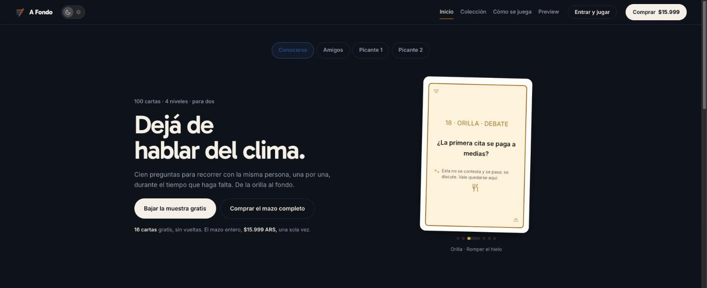
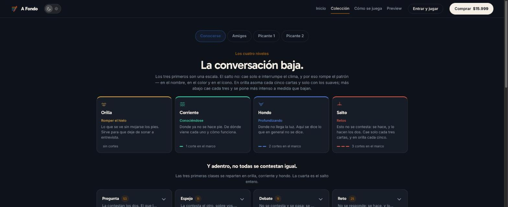

# A Fondo

**100 preguntas para conversar entre dos**, repartidas en cuatro niveles que van de la orilla al fondo.

🔗 **Sitio en vivo:** [a-fondo.pages.dev](https://a-fondo.pages.dev)

> Este repositorio es una vitrina del proyecto. El código fuente está en un repositorio privado porque incluye el contenido pago de los mazos.

## Qué es

Un juego de cartas digital para conversar con la misma persona a lo largo del tiempo. No hay partida ni reloj: se saca una carta y se está en ella todo lo que haga falta. El progreso queda guardado y se sigue otro día.

| Nivel | | Qué hace |
|---|---|---|
| **Orilla** | Romper el hielo | Lo que se ve sin mojarse los pies |
| **Corriente** | Conociéndose | Donde ya no se hace pie |
| **Hondo** | Profundizando | Donde no llega la luz |
| **Salto** | Retos | Esto no se contesta: se hace |

## Qué hice

Es un producto propio: lo diseñé, lo desarrollé y lo vendo online.

- Sitio en páginas (Inicio, Colección, Cómo se juega, Preview) con tema claro y oscuro y animaciones de entrada.
- El juego en el navegador: niveles que se desbloquean con lo que ya recorrieron juntos y progreso guardado.
- Varios mazos (Conocerse, Amigos, Picante 1 y 2), muestras gratis en PDF y venta del mazo completo.
- Un sistema visual de niveles pensado para la accesibilidad.

## Decisiones de diseño

- **Los cortes en el marco.** Cada carta tiene tantos cortes en el marco como hondo está el nivel: orilla ninguno, corriente uno, hondo dos, salto tres. Así el nivel se reconoce sin depender del color, incluso impreso en blanco y negro.
- **Orilla va en orden, el resto al azar.** La secuencia de orilla está escrita a mano, de lo más fácil a lo más pensado; los otros niveles se barajan.
- **Las cartas más intensas no abren un nivel.** En los niveles barajados, una carta de intensidad alta no puede caer entre las cuatro primeras.

## Stack

`JavaScript` `HTML` `CSS` `Cloudflare Pages`

---

Hecho por [Andrea Soteldo](https://andrea-soteldo.pages.dev)
